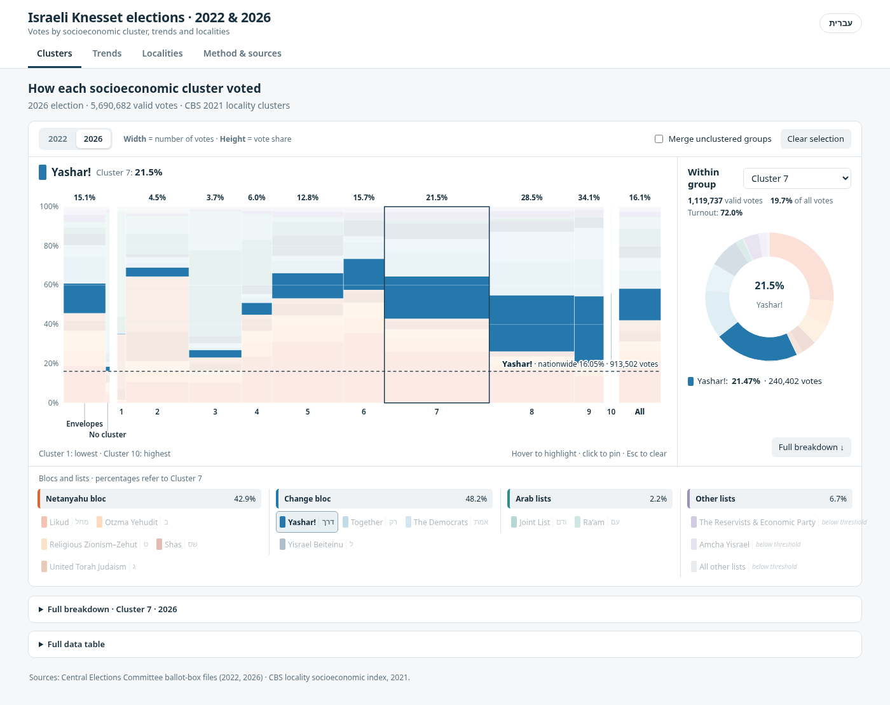

# Israeli elections 2022 & 2026: clusters, trends, localities

A static, bilingual (Hebrew/English) dashboard and a reproducible, standard-library
Python pipeline built on the Central Elections Committee ballot-box exports for the
2022 and 2026 Knesset elections and the CBS 2021 locality socioeconomic clusters.

**Live site:** https://yyogo.github.io/israel-elections/ (English: `?lang=en`)

| Tab | What it shows |
| --- | --- |
| Clusters | Proportional-width stacked columns per socioeconomic cluster (width = votes, height = share), by neighbourhood (CBS statistical areas) or by locality, a nationwide column, a doughnut for the selected group, and a 2022/2026 switch |
| Trends | National bloc and turnout changes, an **estimated 2022 → 2026 vote-flow Sankey** (blocs or lists), change by cluster, and change by locality |
| Localities | Search any locality and compare its two elections; largest shifts by bloc and turnout |
| Method & sources | Assumptions, caveats and sources |



## Build

Python 3.10+, standard library only. No network access needed.

```sh
python3 scripts/verify_manifest.py   # immutable inputs match SHA256SUMS
python3 scripts/analyze.py           # normalized and aggregated tables, audits
python3 scripts/flows.py             # ecological-inference vote flows (~40 s)
python3 scripts/build_dashboard.py   # dist/index.html, fully self-contained
python3 -m http.server 8000 --directory dist
```

The ballot-box → statistical-area crosswalk (`data/derived/geo/`) is built offline, because
it needs GIS packages: `pip install -r scripts/geo/requirements.txt` and then
`python3 scripts/geo/build_ballot_areas.py`. See `data/raw/geo/README.md` for sources and
licences (the 2022 venue list is CC BY-NC-SA 4.0).

The published vote-flow estimates come from a stratified Bayesian model fitted offline
(`scripts/ei/bayes_flows.py`, NumPyro; about 15 minutes on 16 cores for both levels):

```sh
uv venv -p 3.12 .venv-ei && VIRTUAL_ENV=.venv-ei uv pip install -r scripts/ei/requirements.txt
python3 scripts/flows.py                       # writes flows_units_*.csv
.venv-ei/bin/python scripts/ei/bayes_flows.py --level bloc
.venv-ei/bin/python scripts/ei/bayes_flows.py --level list
python3 scripts/flows.py && python3 scripts/build_dashboard.py
```

Its posterior draws are committed, so CI only reruns the standard-library steps.

Pushes to `main` rebuild and deploy to GitHub Pages through
`.github/workflows/pages.yml` (Settings → Pages → Source: GitHub Actions).

The optional browser smoke test is described in `tests/README.md`.

## Layout

```text
data/raw/            Original exports, byte-for-byte (see SHA256SUMS)
data/derived/        Rebuildable tables: per-year ballots/settlements/clusters, flows, dashboard data
src/parties.json     List names (he/en), ballot letters, blocs, colours, logos for both years
src/js/              Dashboard source: i18n, util, clusters, trends, settlements, app
src/styles.css       Styles
src/index.template.html
scripts/             analyze.py, flows.py, build_dashboard.py, verify_manifest.py, xlsx.py
scripts/geo/         Offline ballot-box → statistical-area join (GIS packages)
scripts/ei/          Offline stratified Bayesian vote-flow model (NumPyro)
archive/             Earlier chart reports; their CSVs are independent controls for analyze.py
docs/                Methodology, data dictionary, validation, deployment notes
vendor/              Pinned Apache ECharts 5.6.0
```

## Scope and limits

- In the neighbourhood view, a ballot box takes the cluster of the statistical area its polling
  place is in (81 divided municipalities). Elsewhere, and in the locality view, the whole
  locality's cluster is used. Neither is a voter-income analysis.
- External-envelope votes (code 9999) have no locality and are kept as a separate group.
- Ballot letters and list membership change between elections. Join party identities on
  **year + ballot_code**. Cross-year comparisons use blocs, which are a presentation grouping.
- The vote flows are a statistical estimate (see `docs/METHODOLOGY.md`), not observed transfers.

Method details and caveats: `docs/METHODOLOGY.md`; table schemas: `docs/DATA_DICTIONARY.md`.
